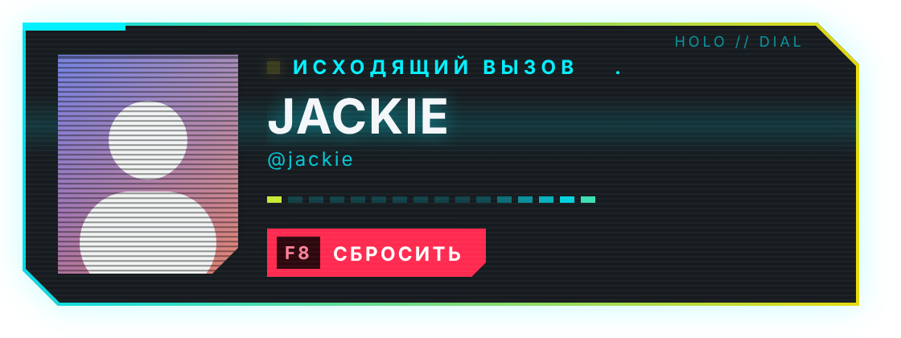
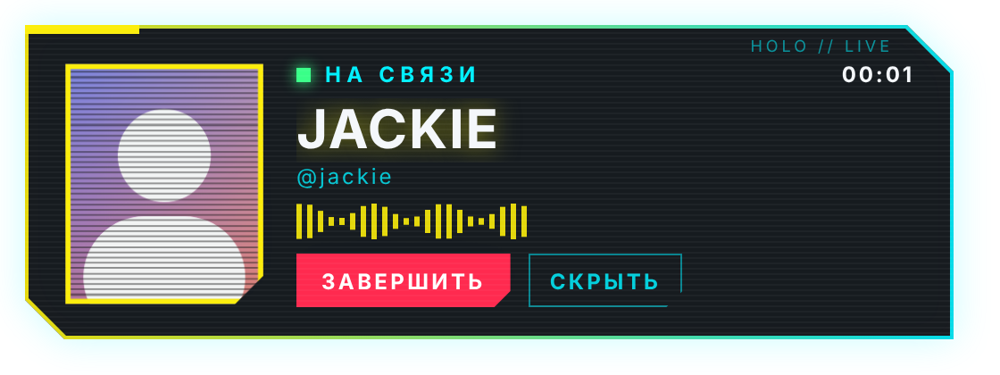

# CyberCall

Входящий звонок Discord в киберпанк-стиле: панель с глитч-анимацией поверх игр и рабочего стола,
свой рингтон, кнопки «Принять» / «Отклонить» и горячие клавиши. Плагин для Vencord.

Когда звонишь сам, показывается панель исходящего вызова с кнопкой сброса:

После ответа остаётся панель разговора: таймер, а аватарка и индикатор оживают, когда собеседник говорит.
Анимированные аватарки (Nitro) двигаются сами.

## Установка

1. Скачай `CyberCall-win.zip` со страницы [последнего релиза](../../releases/latest).
2. Распакуй архив целиком.
3. Запусти `install.bat`. Он закроет Discord, подключит сборку и запустит Discord снова.
4. В Discord: Настройки → Vencord → Plugins → включи **CyberCall**.
5. Там же в настройках плагина нажми «Показать тестовый звонок».

Git, Node.js и сборка не нужны: релиз уже собран. Удаление — `uninstall.bat`.

## Обновления

Плагин обновляется сам: при запуске Discord и каждые 3 часа он проверяет последний релиз, скачивает новую сборку,
сверяет файлы по SHA-256 и показывает уведомление. Новая версия включается после перезапуска Discord.
Вместе с плагином обновляется и сам Vencord — сборка пересобирается раз в неделю.

Выключить автообновление или проверить вручную можно в настройках плагина.

## Настройки

- **Клавиши** — по умолчанию F7 принять, F8 отклонить или сбросить свой вызов. Перехватываются только пока идёт звонок.
- **Исходящий вызов** — панель, когда звонишь ты; можно выключить.
- **Панель разговора** — висит, пока идёт звонок; можно скрыть кнопкой или выключить совсем.
- **Угол экрана** — по умолчанию слева сверху.
- **Рингтон** — встроенный; можно указать путь к своему файлу (mp3, ogg, wav, m4a, flac) и громкость.

Чтобы стандартный звонок Discord не играл поверх рингтона, выключи его:
Настройки Discord → Уведомления → Звуки → «Входящий звонок».

## Важно

- Игра должна быть в режиме «без рамки» (borderless). Поверх эксклюзивного полноэкранного режима
  Windows не показывает чужие окна.
- Окно оверлея создаётся только на время звонка, в остальное время плагин память не занимает.
- Vencord — неофициальная модификация клиента, формально это против правил Discord.

## Сборка вручную

Скопируй папку `cyberCall.desktop` в `Vencord/src/userplugins/`, затем `pnpm build` и `pnpm inject`.

Лицензия GPL-3.0, как у [Vencord](https://github.com/Vendicated/Vencord).
