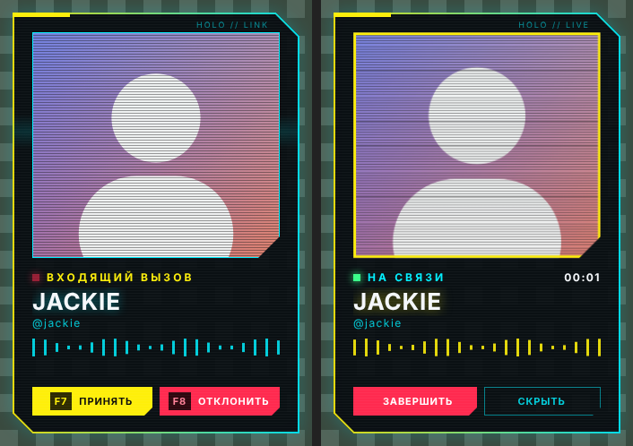
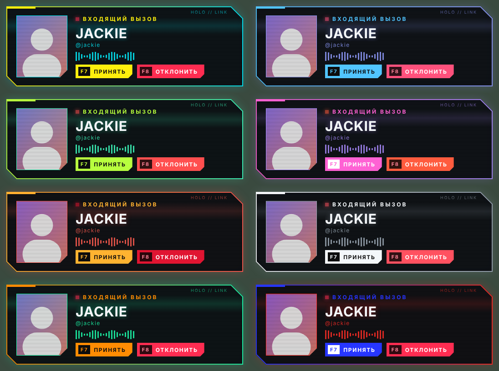
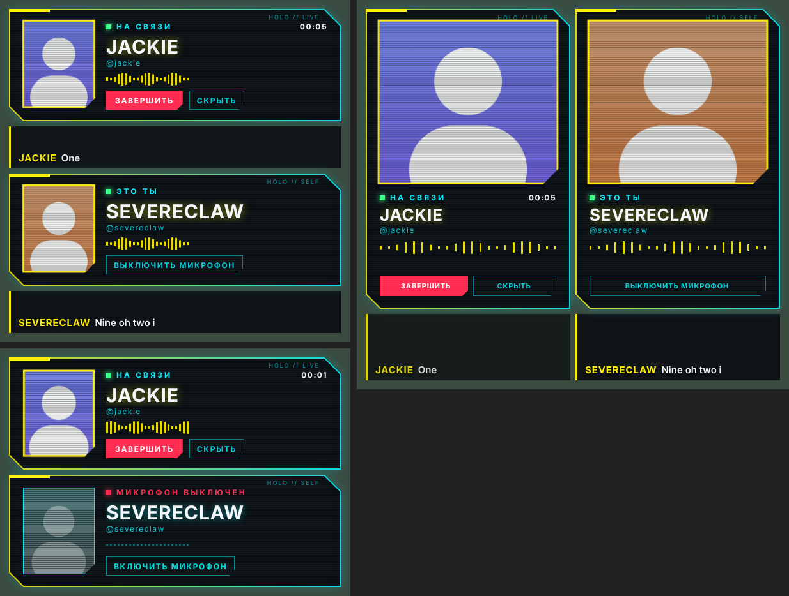

# CyberCall

Входящий звонок Discord в киберпанк-стиле: панель с глитч-анимацией поверх игр и рабочего стола,
свой рингтон, кнопки «Принять» / «Отклонить» и горячие клавиши. Плагин для Vencord.

Когда звонишь сам, показывается панель исходящего вызова с кнопкой сброса:

После ответа остаётся панель разговора: таймер, а аватарка и индикатор оживают, когда собеседник говорит.
Анимированные аватарки (Nitro) двигаются сами.

Крупный вид:

Палитры и свои цвета:

## Установка

1. Скачай `CyberCall-win.zip` со страницы [последнего релиза](../../releases/latest).
2. Распакуй архив целиком.
3. Запусти `install.bat`. Он закроет Discord, подключит сборку и запустит Discord снова.
4. В Discord: Настройки → Vencord → Plugins → включи **CyberCall**.
5. Там же в настройках плагина нажми «Показать тестовый звонок».

Git, Node.js и сборка не нужны: релиз уже собран. Удаление — `uninstall.bat`.

## Субтитры

Выключаются в настройках плагина. Речь распознаётся прямо на компьютере (движок [Vosk](https://alphacephei.com/vosk/)),
звук никуда не отправляется.

- **Моё окно** — во время разговора рядом с панелью собеседника стоит такая же панель с твоим ником и аватаркой — отдельным окном.
  Она оживает, когда говоришь ты, в ней есть кнопка микрофона, а с включёнными субтитрами под ней идёт текст твоей речи
  (берётся микрофон, выбранный в Discord). Когда микрофон выключен, твоя речь не распознаётся. Можно отключить в настройках.
- При первом включении плагин сам скачает движок и модель языка — около 45 МБ на язык.
- Discord не отдаёт голос собеседника отдельно, поэтому плагин слушает общий звук компьютера, но только в те моменты,
  когда Discord показывает, что собеседник говорит. Громкая игра или музыка всё равно ухудшают текст.
- С виртуальным микшером (Voicemeeter и подобные) Discord может выводить звук не в устройство по умолчанию. Поэтому в начале
  звонка плагин слушает сразу несколько источников (звук компьютера и устройства записи) и оставляет тот, где громко именно
  тогда, когда собеседник говорит. Выбор запоминается. Чтобы это работало, голос Discord должен попадать хотя бы в одну
  шину записи микшера (например, Voicemeeter Out B2).
- Модель маленькая (для русского — vosk-model-small-ru-0.22): простую речь понимает, имена, сленг и мат — плохо.
- **Языки** — по умолчанию русский и английский сразу: обе модели слушают каждую реплику, и после паузы показывается
  вариант той, что уверена сильнее. При смене языка первые слова реплики могут мелькнуть на старом языке. Режим «оба»
  занимает вдвое больше памяти (около 800 МБ во время звонка); можно оставить один язык.
- Фразы, в которых распознаватель сильно не уверен (обычно шум или игра), не показываются.
- Пока идёт звонок с субтитрами, окно панели занимает заметно больше памяти (модель загружена целиком).

## Обновления

Плагин обновляется сам: при запуске Discord и каждые 30 минут он проверяет последний релиз, скачивает новую сборку,
сверяет файлы по SHA-256 и показывает уведомление. Новая версия включается после перезапуска Discord.
Вместе с плагином обновляется и сам Vencord — сборка пересобирается раз в неделю.

Какая сборка установлена, видно внизу настроек плагина. Там же кнопка «Скопировать журнал»: если что-то не работает,
журнал показывает, что плагин увидел и что решил показать.

Выключить автообновление или проверить вручную можно в настройках плагина.

## Настройки

- **Клавиши** — по умолчанию F7 принять, F8 отклонить или сбросить свой вызов. Перехватываются только пока идёт звонок.
- **Исходящий вызов** — панель, когда звонишь ты; можно выключить.
- **Панель разговора** — висит, пока идёт звонок; можно скрыть кнопкой или выключить совсем.
- **Место** — панель перетаскивается мышкой за любое место, кроме кнопок; позиция запоминается. Окно собеседника и своё окно
  двигаются отдельно. Можно вернуть любой из четырёх углов.
- **Размер** — Ctrl + колесо мыши над окном, от 50 до 200 %; у каждого окна свой размер, он запоминается.
- **Вид** — обычная панель или крупная карточка с большой аватаркой.
- **Монитор** — тот, где сейчас курсор (по умолчанию), основной или конкретный по номеру. Действует для панели в углу.
- **Цвета** — шесть готовых палитр или свой акцентный цвет, второй цвет подбирается сам.
- **Субтитры** — текст речи собеседника под панелью разговора, русский или английский. Включены по умолчанию.
- **Рингтон** — встроенный; можно указать путь к своему файлу (mp3, ogg, wav, m4a, flac) и громкость.

Рингтон играет и на входящем, и на исходящем вызове (для исходящего можно выключить). Пока он играет, стандартная мелодия и гудки Discord глушатся автоматически (тоже можно выключить).
Если она всё равно слышна, выключи её вручную: Настройки Discord → Уведомления → Звуки → «Входящий звонок».

## Важно

- Игра должна быть в режиме «без рамки» (borderless). Поверх эксклюзивного полноэкранного режима
  Windows не показывает чужие окна.
- Окно оверлея создаётся только на время звонка, в остальное время плагин память не занимает.
- Vencord — неофициальная модификация клиента, формально это против правил Discord.

## Сборка вручную

Скопируй папку `cyberCall.desktop` в `Vencord/src/userplugins/`, затем `pnpm build` и `pnpm inject`.

Лицензия GPL-3.0, как у [Vencord](https://github.com/Vendicated/Vencord).
